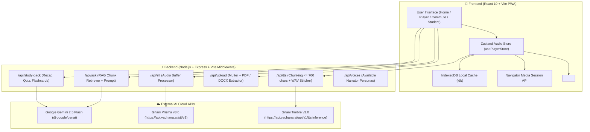

# 🎙️ Pushtak.fm — "Listen to Anything" Platform

> **A calm, high-performance "Listen to Anything" audio platform and Progressive Web Application (PWA).** Turn any 500-page book, academic textbook, PDF, DOCX, TXT file, or syllabus into structured, human-like audio chapters that never cut mid-sentence.


[](https://nodejs.org/)
[](https://react.dev/)
[](https://www.typescriptlang.org/)
[](https://vitejs.dev/)
[](https://tailwindcss.com/)
[](https://web.dev/progressive-web-apps/)
[](LICENSE)

---

## 📑 Table of Contents

- [Overview](#-overview)
- [Key Features](#-key-features)
- [Architecture & Data Flow](#-architecture--data-flow)
- [AI Engine & Models](#-ai-engine--models)
- [Tech Stack](#-tech-stack)
- [Quick Start (Local Development)](#-quick-start-local-development)
- [Environment Configuration](#-environment-configuration)
- [API Reference](#-api-reference)
- [Mobile PWA & Media Session Guide](#-mobile-pwa--media-session-guide)
- [Docker Deployment](#-docker-deployment)
- [Free Cloud Deployment Recommendations](#-free-cloud-deployment-recommendations)
- [Project Directory Structure](#-project-directory-structure)
- [Troubleshooting & Diagnostics](#-troubleshooting--diagnostics)

---

## 🌟 Overview

**Pushtak.fm** is designed for modern commuters, students, and busy professionals who want to consume dense written material on the go. Unlike traditional mechanical screen readers:

- It intelligently parses lengthy texts into **bite-sized listening sections** (e.g., 5 to 15-minute commute chapters) broken strictly at paragraph and sentence boundaries.
- It synthesizes audio using **Gnani Timbre v3.0**, producing warm, natural Indian accents and 10+ regional Indian languages (Hindi, Tamil, Telugu, Kannada, Bengali, Marathi, Punjabi, Gujarati, Malayalam, and English).
- It provides an **interactive AI Study Pack** and **Grounded RAG Q&A ("Ask the Book")** powered by **Google Gemini 2.5 Flash**, enabling listeners to speak or type questions and receive factually grounded answers strictly cited from the text.
- It is engineered as a **mobile-first PWA** with full background audio playback, lock-screen scrubbing controls, and dynamic album artwork generated via HTML5 Canvas.

---

## ✨ Key Features

### 🎧 1. Zero-Gap Audio Streaming & Native MediaSession
- **Single Persistent Audio Element**: Prevents mobile browsers (iOS Safari, Android Chrome) from killing background playback when switching sections.
- **Background Pre-Synthesis**: Synthesizes and pre-caches the upcoming section into **IndexedDB** while the current section plays, enabling instantaneous transitions without buffering pauses.
- **Hardware & Lock Screen Controls**: Fully integrates with `navigator.mediaSession` — control Play, Pause, Next Track, Previous Track, and Seek ($\pm 15$s) from your lock screen, notification tray, Apple Watch, or Bluetooth headphones (Galaxy Buds, AirPods, car infotainment).
- **Dynamic Book Cover Canvas**: Automatically renders a high-resolution 512x512 terracotta-themed book cover with dynamic typography directly to the OS media notification.

### 📚 2. Multi-Format Book Ingestion
- Upload **PDFs** (`pdf-parse`), **Word documents** (`mammoth` DOCX), or **plain text files** (`.txt`), or paste text directly.
- Handles documents up to **50 MB** in size.
- Smart chunking algorithm segments material based on target commute duration (e.g., 5 min, 10 min, 15 min, 20 min) without splitting mid-sentence.

### 💬 3. "Ask the Book" (Grounded RAG)
- Listener can ask questions at any time using voice or text.
- Uses **BM25 + Semantic Term Match** chunk retrieval to pull the top 4 relevant passages from the active book.
- Powered by **Google Gemini 2.5 Flash** with strict anti-hallucination grounding prompt: answers only from retrieved excerpts and includes exact section citations.

### 🎓 4. Student Mode & AI Study Packs
- **30-Second Audio Recap**: Instant distillation of key insights for quick review before class or meetings.
- **Interactive 3-Question Quiz**: Self-assessment with instant feedback, explanations, and score tracking.
- **Spaced Repetition Flashcards**: Interactive flip cards capturing core definitions and principles.
- **Hinglish / Simplified Explanation**: Breaks down dense academic jargon into conversational, intuitive language.

### 🚗 5. Commute Mode
- High-contrast, driving-safe user interface featuring oversized touch targets.
- Single-tap 15-second rewinds, voice questions, and quick playback speed toggles (0.75x to 2.0x).

### 🛡️ 6. Robust Multi-Tier Fallback Architecture
- **Text-to-Speech**: If Gnani Timbre is unreachable or network is offline, automatically switches to the browser's native Web Speech Synthesis (`window.speechSynthesis`) with a truthful UI toast.
- **Speech-to-Text**: If Gnani Prisma is unavailable, falls back to browser Web Speech Recognition or Gemini Audio transcription.
- **IndexedDB Caching**: Audio sections are hashed by `SHA-256(text + voice + language + speed)` and stored locally in IndexedDB to minimize repeat API calls and preserve quota.

---

## 🏗️ Architecture & Data Flow



---

## 🤖 AI Engine & Models

| Service | Engine / Model | Endpoint / Provider | Specification |
| :--- | :--- | :--- | :--- |
| **TTS (Speech)** | **Gnani Timbre v3.0** | `https://api.vachana.ai/api/v1/tts/inference` | 24,000 Hz, 1-channel, 16-bit linear PCM WAV; Voices: Lakshmi, Vasudha, Shivani, Yashraj, Prakash, Avinash |
| **STT (Voice Input)** | **Gnani Prisma v3.0** | `https://api.vachana.ai/stt/v3` | 16-bit Mono WAV, model: `prisma-v3.0`, `language_code: indic-auto` |
| **Grounded Q&A (RAG)** | **Google Gemini 2.5 Flash** | `@google/genai` SDK | Prompt-grounded contextual search over segmented book chunks |
| **Study Pack Generator** | **Google Gemini 2.5 Flash** | `@google/genai` SDK | Generates structured JSON (Recap, 3-question Quiz, Flashcards, Hinglish notes) |
| **Fallback Speech** | **Browser Web Speech API** | Client Hardware Native | Zero-latency fallback when offline or during API outage |

---

## 🛠️ Tech Stack

### Frontend
- **React 19** (`react`, `react-dom`)
- **TypeScript 5.x**
- **Vite 8.x** with `@tailwindcss/vite`
- **Tailwind CSS v4** (Modern utility-first styling)
- **Framer Motion (`motion`)** (Fluid page transitions and player animations)
- **Lucide React** (Crisp vector icons)
- **Zustand** (Global state management)
- **idb (IndexedDB)** (Persistent offline audio caching)
- **vite-plugin-pwa** (Service Worker generation and web manifest)

### Backend
- **Node.js 22.x** with **Express 4.x**
- **tsx** (Ultra-fast TypeScript execution engine)
- **Multer** (Multipart memory streaming for files up to 50MB)
- **pdf-parse** (PDF text extraction)
- **mammoth** (DOCX structure and raw text extraction)
- **@google/genai** (Official Google GenAI SDK for Gemini)
- **dotenv** (Environment variable isolation)

---

## 🚀 Quick Start (Local Development)

### 1. Prerequisites
- **Node.js**: v20.x or v22.x installed ([Download Node.js](https://nodejs.org/))
- **npm**: v10.x or higher

### 2. Clone and Navigate
```bash
git clone https://github.com/your-username/pushtak-fm.git
cd pushtak-fm/Pushtak.Fm-main-main
```

### 3. Install Dependencies
```bash
npm install
```

### 4. Configure Environment Variables
Create a `.env` file in the project folder (or copy `.env.example`):
```bash
cp .env.example .env
```
Fill in your credentials:
```env
# Gnani AI Key (Timbre v3.0 TTS & Prisma v3.0 STT)
GNANI_API_KEY="your_gnani_vachana_api_key_here"

# Google Gemini API Key (Gemini 2.5 Flash for RAG Q&A and Study Packs)
GEMINI_API_KEY="your_gemini_api_key_here"

# Application URL
APP_URL="http://localhost:3000"
```

### 5. Start the Full-Stack Dev Server
```bash
npm run dev
```
The server will start at:
👉 **`http://localhost:3000`**

Open your browser and navigate to `http://localhost:3000` to test the app!

---

## ⚙️ Environment Configuration

| Variable | Required? | Default / Description |
| :--- | :--- | :--- |
| `GNANI_API_KEY` | **Recommended** | API Key from [Vachana / Gnani AI](https://vachana.ai/). Required for high-fidelity Timbre v3.0 TTS & Prisma STT. *(If absent, system automatically falls back to browser voice).* |
| `GEMINI_API_KEY` | **Recommended** | API Key from [Google AI Studio](https://aistudio.google.com/). Required for "Ask the Book" RAG and Student Study Packs. |
| `DATABASE_URL` | Optional | PostgreSQL connection string (e.g. from Render Managed PostgreSQL). If omitted, the server automatically runs in in-memory storage mode. |
| `PORT` | Optional | Server port (Default: `3000`). |
| `APP_URL` | Optional | Canonical URL where the app is hosted (e.g. `http://localhost:3000` or production domain). |
| `GNANI_TTS_ENDPOINT`| Optional | Custom override for Timbre TTS (Default: `https://api.vachana.ai/api/v1/tts/inference`). |
| `GNANI_STT_ENDPOINT`| Optional | Custom override for Prisma STT (Default: `https://api.vachana.ai/stt/v3`). |

---

## 📡 API Reference

All backend routes are hosted under `/api/*` and protected against browser exposure:

### 1. Health Status
- **`GET /api/health`**
- Returns engine status and model configurations.
```json
{
  "status": "ok",
  "app": "Pushtak.fm",
  "models": {
    "tts": { "engine": "Gnani Timbre v3.0 (timbre-v3.0)", "configured": true },
    "stt": { "engine": "Gnani Prisma v3.0 (prisma-v3.0)", "configured": true },
    "llm": { "engine": "Gemini 2.5 Flash", "configured": true }
  }
}
```

### 2. Live Diagnostics
- **`GET /api/diagnostics`**
- Executes a live end-to-end ping against both Timbre v3.0 and Prisma v3.0 to verify connectivity and credentials.
```json
{
  "tts": { "pass": true, "httpStatus": 200, "bytesReceived": 53804 },
  "stt": { "pass": true, "httpStatus": 200, "transcript": "" }
}
```

### 3. Voices List
- **`GET /api/voices`**
- Returns all 6 verified Gnani narrator personas (`Lakshmi`, `Vasudha`, `Shivani`, `Yashraj`, `Prakash`, `Avinash`) with voice descriptions and sample sentences.

### 4. Preloaded Demo Book
- **`GET /api/demo-book?targetMinutes=5`**
- Returns the preloaded demo book (*The Art of Deep Focus & Mindful Living*) partitioned into sections.

### 5. Document Ingestion
- **`POST /api/upload`** (`multipart/form-data` or JSON)
- Fields: `file` (PDF/DOCX/TXT), `title`, `author`, `targetMinutes` (commute length: 5, 10, 15, 20).
- Automatically cleans text, extracts structure, and indexes chunks into the RAG memory store.

### 6. Text-to-Speech Synthesis
- **`POST /api/tts`** (JSON)
- Body: `{ "text": "...", "voice": "Lakshmi", "language": "auto", "speed": 1.0 }`
- Chunks text at $\le 700$ characters, strips SSML/angle brackets, fetches PCM WAVs, stitches them seamlessly, and returns `audio/wav` binary data.

### 7. Speech-to-Text Transcription
- **`POST /api/stt`** (`multipart/form-data`)
- Fields: `audio_file` (WAV audio blob), `language_code` (`indic-auto`).
- Transcribes user speech for voice questions in Ask the Book.

### 8. Ask the Book (Grounded RAG)
- **`POST /api/ask`** (JSON)
- Body: `{ "question": "What is Deep Focus?", "bookId": "demo-deep-focus", "bookTitle": "...", "language": "en" }`
- Ranks candidate chunks using BM25 semantic scoring, queries Gemini 2.5 Flash, and returns answer + citations.

### 9. Student Study Pack
- **`POST /api/study-pack`** (JSON)
- Body: `{ "sectionTitle": "Chapter 1", "sectionText": "...", "language": "en" }`
- Returns structured JSON containing a 30s recap, 3 interactive quiz questions, flashcards, and a Hinglish explanation.

---

## 📱 Mobile PWA & Media Session Guide

Pushtak is built to behave like a native streaming app (Spotify / Apple Music) on iOS and Android:

### Installing the PWA
1. **Android (Chrome)**: Open the HTTPS URL $\rightarrow$ tap the menu (⋮) $\rightarrow$ **"Add to Home Screen"** or tap the in-app **Install App** button.
2. **iOS (Safari)**: Open the HTTPS URL $\rightarrow$ tap the **Share** button $\rightarrow$ tap **"Add to Home Screen"**.

### Lock-Screen & Bluetooth Behavior
- When audio is playing, lock the phone.
- The lock screen displays the book title, section title, and dynamic terracotta album cover.
- Scrubber advances smoothly in real time.
- Bluetooth headphone clicks (play/pause/skip) control playback without waking the screen.
- Auto-saves progress every 5 seconds and resumes at the exact second upon return.

> [!NOTE]
> Modern mobile browsers require an initial user tap before audio can play. Once initiated, Pushtak maintains background session persistence across all consecutive track transitions.

---

## 🐳 Docker Deployment

A production-ready `Dockerfile` and `docker-compose.yml` are included.

### Run with Docker Compose
```bash
# 1. Provide your environment variables in docker-compose.yml or export them
export GNANI_API_KEY="your_gnani_key"
export GEMINI_API_KEY="your_gemini_key"

# 2. Build and start container
docker-compose up -d --build

# 3. Access on http://localhost:3000
```

### Manual Docker Build
```bash
docker build -t pushtak-fm .
docker run -p 3000:3000 -e GNANI_API_KEY="your_key" -e GEMINI_API_KEY="your_key" pushtak-fm
```

---

## 🌐 Free Cloud Deployment Recommendations

Since **Pushtak.fm** is a full-stack application (combining an Express backend for secure API proxying and a Vite React frontend), it requires a host that supports Node.js or Docker web processes. Here are the top free platforms recommended:

| Provider | Free Tier Details | Best For | Link |
| :--- | :--- | :--- | :--- |
| **Render** ⭐ *(Recommended)* | Free Web Service (512MB RAM, automatic HTTPS, Git auto-deploy, spins down on idle) | **Easiest setup, native Node.js support** | [render.com](https://render.com) |
| **Koyeb** | Free Eco nano instance (512MB RAM, continuous running, global CDN) | **Fastest global latency, zero idle spin-down** | [koyeb.com](https://koyeb.com) |
| **Fly.io** | Generous free allowance (3 shared-cpu-1x VMs, 256MB RAM each) | **Best for Dockerized multi-region deployment** | [fly.io](https://fly.io) |
| **Hugging Face Spaces** | Free Docker or Node Spaces with generous CPU and 16GB RAM | **AI community demos & portfolios** | [huggingface.co/spaces](https://huggingface.co/spaces) |

---

### 🚀 Step-by-Step Guide: Deploying Free on Render

Render is the simplest zero-cost choice for hosting Pushtak.fm:

#### Step 1: Push Code to GitHub
Ensure your repository is pushed to GitHub (make sure `.env` is **not** committed — it is already in `.gitignore`).

#### Step 2: Create a New Web Service on Render
1. Sign up / log in to [Render.com](https://render.com).
2. Click **New +** $\rightarrow$ select **Web Service**.
3. Connect your GitHub repository.

#### Step 3: Configure Settings
- **Name**: `pushtak-fm` (or your preferred name)
- **Region**: Choose the region closest to your users (e.g., *Singapore* or *Frankfurt*)
- **Branch**: `main`
- **Root Directory**: `Pushtak.Fm-main-main` *(if your code is in the subfolder)* or leave blank if in repository root.
- **Runtime**: `Node`
- **Build Command**:
  ```bash
  npm install && npm run build
  ```
- **Start Command**:
  ```bash
  npm start
  ```
- **Instance Type**: Select **Free** ($0/month).

#### Step 4: Add Environment Variables & Database
In the Render dashboard under **Environment Variables**, add:
- `GNANI_API_KEY` = *(your Vachana/Gnani API key)*
- `GEMINI_API_KEY` = *(your Google AI Studio key)*
- `NODE_ENV` = `production`
- `PORT` = `3000`

*(Optional but Recommended)* **Attach Free Render PostgreSQL**:
1. In Render Dashboard, click **New +** $\rightarrow$ **PostgreSQL**.
2. Name: `pushtak-db`, Plan: **Free**, click **Create Database**.
3. Under your Web Service **Environment**, add `DATABASE_URL` and paste the **Internal Database URL** (or link the database directly).
4. Pushtak.fm will auto-create all database tables on startup!

#### Step 5: Deploy!
Click **Create Web Service**. Render will install dependencies, build the Vite production bundle, start the Express server, and provide a free `https://pushtak-fm.onrender.com` domain with automatic SSL (required for PWA and Media Session APIs).

---

### ⚡ Alternative: Deploying Free on Koyeb

1. Sign up at [Koyeb.com](https://koyeb.com).
2. Click **Create App** $\rightarrow$ **GitHub**.
3. Select your repo.
4. Set Build command: `npm install && npm run build` and Run command: `npm start`.
5. Under Environment variables, add `GNANI_API_KEY`, `GEMINI_API_KEY`, `PORT=3000`, and `NODE_ENV=production`.
6. Click **Deploy**. Your app will be live on `https://<your-app>.koyeb.app`.

---

## 📁 Project Directory Structure

```
Pushtak.fm/
├── public/                 # Static PWA assets, icons & manifests
│   ├── icon.svg
│   ├── icon-192.png
│   └── icon-512.png
├── server/                 # Express backend services
│   ├── config/
│   │   ├── gnani.ts        # Gnani AI & Gemini configuration
│   │   └── voices.config.ts# Narrator voice profiles
│   ├── data/
│   │   └── demoBook.ts     # Preloaded demo book content
│   ├── db/
│   │   └── postgres.ts     # Render PostgreSQL adapter & schema auto-migrator
│   └── services/
│       ├── bookParser.ts   # PDF/DOCX/TXT extraction & chunking
│       ├── llmService.ts   # Gemini 2.5 Flash RAG & Study Pack generator
│       ├── ragService.ts   # BM25 + semantic similarity search
│       ├── sttService.ts   # Prisma v3.0 voice transcription
│       ├── ttsService.ts   # Timbre v3.0 TTS chunking & WAV stitcher
│       └── voiceService.ts # Voice listing service
├── src/                    # React 19 Frontend application
│   ├── components/
│   │   ├── AskBook/        # Grounded Q&A dialog & voice interface
│   │   ├── CommuteMode/    # Driving-safe large button interface
│   │   ├── Home/           # Hero upload, feature showcases
│   │   ├── Library/        # User library & reading progress
│   │   ├── Player/         # FullScreenPlayer, MiniPlayer, AudioBar
│   │   ├── StudentMode/    # Recaps, Quizzes, Flashcards, Hinglish notes
│   │   └── Voice/          # Narrator selection modal
│   ├── context/            # React settings context
│   ├── hooks/              # usePWAInstall, useOnlineStatus
│   ├── services/
│   │   ├── audioPlayer.ts  # Singleton persistent audio manager & MediaSession
│   │   └── db.ts           # IndexedDB audio & book persistence
│   ├── stores/
│   │   └── usePlayerStore.ts # Global Zustand playback state
│   ├── App.tsx             # Root React component
│   ├── index.css           # Tailwind v4 styles & design tokens
│   └── main.tsx            # Vite client entry point
├── Dockerfile              # Multi-stage production container
├── docker-compose.yml      # Container orchestration
├── package.json            # Node dependencies and scripts
├── server.ts               # Express full-stack HTTP server & Vite middleware
├── tsconfig.json           # TypeScript configuration
└── vite.config.ts          # Vite build, PWA & Tailwind configuration
```

---

## 🔍 Troubleshooting & Diagnostics

### 1. Run Live Diagnostics
Pushtak includes a built-in diagnostic endpoint to verify external AI credentials:
```bash
curl http://localhost:3000/api/diagnostics
```
- If `pass: true` for both TTS and STT, external Gnani APIs are operational.
- If `pass: false` with HTTP 401, check `GNANI_API_KEY` in your `.env` file.

### 2. Audio Fails to Play on Mobile
- **Root Cause**: Mobile browsers strictly enforce user gesture policies. Audio cannot play automatically without a prior user tap.
- **Solution**: Tap **Play** once on the interface. All subsequent chapter/section transitions will happen seamlessly in the background without requiring user intervention.

### 3. Background Audio Stops After Screen Lock
- **Root Cause**: Aggressive battery saver settings on certain Android OEMs (e.g. Xiaomi, Samsung).
- **Solution**: In phone settings $\rightarrow$ Apps $\rightarrow$ Pushtak $\rightarrow$ set Battery to **"Unrestricted"**.

### 4. Port 3000 Already in Use
Specify a custom port:
```bash
PORT=3001 npm run dev
```

---

## 📄 License

This project is licensed under the MIT License — see the [LICENSE](LICENSE) file for details.
